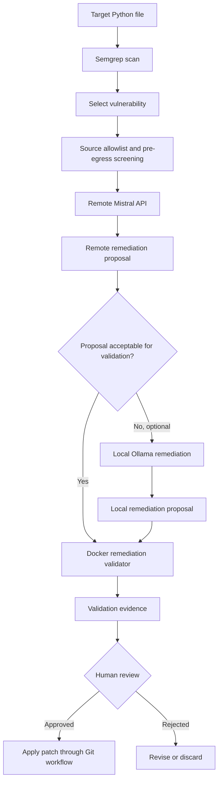

# CybersecurityAgent — Remote Remediation with Optional Local Remediation

The intended process is **remote-first, with local remediation as an optional alternative or fallback**.

This differs from the hybrid pipeline, where remote Mistral performs triage and local Ollama generates remediation proposals.

In the remote-first workflow, **Mistral generates the patch proposal directly**. Local Ollama is invoked only if you choose to generate an alternative proposal or if the remote proposal is inadequate.



The key distinction is that **remote and local remediation generate candidate fixes**. Neither constitutes authorization to modify the original code automatically.

## 1. Remote remediation — primary workflow

The following procedure uses the scripts in the CybersecurityAgent project.

### Step 1 — Select the target file

From PowerShell:

```powershell
cd C:\Users\pjnav\PetroGit\CybersecurityAgent
.\.venv\Scripts\Activate.ps1

$Target = "sast_evidence.py"
```

### Step 2 — Run Semgrep

```powershell
python .\sast_semgrep.py $Target `
  --json-file semgrep-results.json
```

Inspect the findings:

```powershell
$Report = Get-Content .\semgrep-results.json -Raw | ConvertFrom-Json

for ($i = 0; $i -lt $Report.results.Count; $i++) {
    [PSCustomObject]@{
        Index = $i
        Rule = $Report.results[$i].check_id
        File = $Report.results[$i].path
        Line = $Report.results[$i].start.line
    }
}
```

Select the index of the vulnerability to remediate. In the following examples, `0` represents the first finding.

### Step 3 — Generate a remote remediation proposal

```powershell
python .\mistral_remote_remediation.py `
  --mode remediation `
  --repo . `
  --results semgrep-results.json `
  --finding 0 `
  --source $Target `
  --allow-file $Target `
  --approve-external-source
```

The script sends the selected finding metadata and a bounded source excerpt to Mistral after its pre-egress checks. The explicit approval flag authorizes sending the selected source excerpt externally. Review the file for confidential material before approving transmission; automated screening is not a guarantee that all secrets are detected.

Expected outputs:

```text
remediation/
└── remote-proposals/
    ├── finding-0001.md
    └── finding-0001.lint.json
```

- `finding-0001.md`: the proposed remediation.
- `finding-0001.lint.json`: structural assessment results.

Review both files before validation.

## 2. Optional local remediation — alternative proposal

If you want a second proposal without sending source code to Mistral, use the local remediation engine.

### Step 4 — Start Ollama

Ensure Ollama is running and the configured model is available:

```powershell
ollama list
ollama pull ministral-3:3b
```

The local script is configured to use `ministral-3:3b` through `http://127.0.0.1:11434/v1`.

### Step 5 — Generate the local proposal

```powershell
python .\local_remediation.py `
  --repo . `
  --results semgrep-results.json `
  --finding 0 `
  --source $Target
```

Expected output:

```text
remediation/
└── proposals/
    └── finding-0001.md
```

The remote and local proposals are stored in different directories so their assessments, suggested patches and tests can be compared.

**Important:** The local script uses the supplied `--source` path to locate the code, rather than independently confirming that it matches the Semgrep finding. Select the correct source file.

## 3. Validate the selected proposal

Choose either the remote or local proposal.

### Option A — Validate the remote Mistral proposal

```powershell
python .\remediation_validator.py `
  --repo . `
  --proposal remediation/remote-proposals/finding-0001.md `
  --report remediation/validation-remote-0001.json `
  --image cybersecurityagent-validator:local `
  --mode auto
```

### Option B — Validate the local Ollama proposal

```powershell
python .\remediation_validator.py `
  --repo . `
  --proposal remediation/proposals/finding-0001.md `
  --report remediation/validation-local-0001.json `
  --image cybersecurityagent-validator:local `
  --mode auto
```

Before running validation, Docker must be available and the validator image must exist:

```powershell
docker build -f Dockerfile.validator `
  -t cybersecurityagent-validator:local .
```

The validator checks the proposal structure. If an applicable patch is present, it attempts validation in a disposable workspace. Proposals lacking the expected patch or test format may be rejected or treated as triage-only.

## 4. Review and decide

| Validation outcome | Next action |
|---|---|
| Technical PASS | Review the patch and test evidence before applying it |
| Failed validation | Revise the proposal or try the alternative model |
| Triage-only result | Investigate further; no validated patch established |
| Inconclusive | Inspect the validation report and resolve the cause |

Neither remediation generator applies a patch to the original repository.

## 5. Which workflow should you use?

**Default:** Semgrep → Remote Mistral remediation → Docker validation → Human review.

**Optional:** Semgrep → Local Ollama remediation → Docker validation → Human review.

**Comparison:** Generate both proposals for the same finding, validate each independently and select the better-supported correction.

You do not need `hybrid_pipeline.py` for this remote-first process. That script serves the separate hybrid orchestration workflow.

The current implementation supports manual selection of remote or local remediation. It **does not automatically switch to Ollama** when remote remediation fails; that would require an additional orchestration step, which is outside the current procedure.
